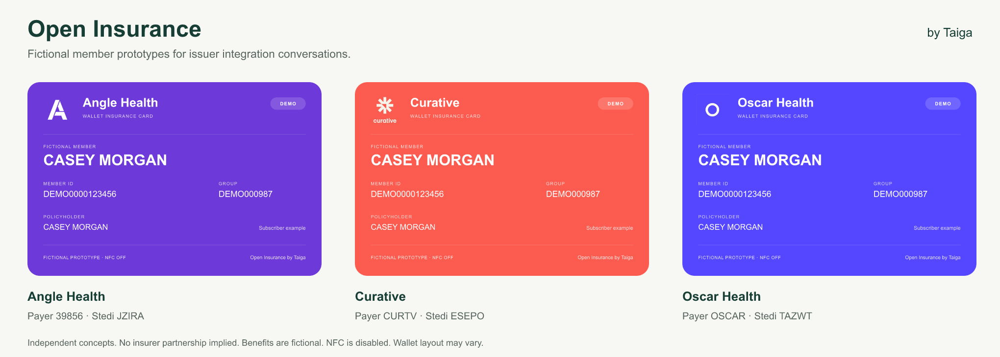

# Open Insurance

**Insurance intake from a Wallet card, with issuer-controlled data.** Created and maintained by [Taiga](https://github.com/useTaiga).

[](https://github.com/useTaiga/open-insurance/actions/workflows/ci.yml) [](LICENSE)

Open Insurance is an MIT-licensed SDK and local lab for issuing branded Apple Wallet insurance cards, resolving their references, and delivering supplied benefits. Its insurance fields match the bundled Stedi legacy eligibility request contract. A new eligibility inquiry is optional.

**Developer preview.** A Wallet download is not proof of NFC functionality. Custom NFC passes require Apple's permission; the included PN532 reader is experimental. This project is not an insurer-issued credential service or a production clinic deployment.

## Try it locally

Install [Bun](https://bun.sh/) using the version in [package.json](package.json), then:

```sh
git clone https://github.com/useTaiga/open-insurance.git
cd open-insurance
bun install --frozen-lockfile
bun run example
bun run dev
```

Open [the issuer lab](http://127.0.0.1:4320). Leave **Include fictional issuer benefits** checked, issue a card, and simulate its read. The lab displays the supplied benefits, their dates, and an optional unsent eligibility request.

The example and lab use fictional members and send no eligibility inquiries. No account, API key, Apple certificate or NFC hardware is needed for this software-only path. Use `INSURANCE_CARD_PORT` to choose another local port.

For branded fictional Angle Health, Curative and Oscar Health bundles, run `bun run prototypes --out /tmp/open-insurance-prototypes`. See [partner prototypes](docs/partner-prototypes.md) for previews, supplied benefits, dependent examples and optional ordinary Wallet signing.



## Use the SDK

For a runnable issuer app with enrollment adapters, a Wallet button and an Apple setup checker, start with [issuer onboarding](docs/issuer-onboarding.md):

```sh
bun run onboarding init --payer angle --out /tmp/angle-insurance
```

The same command supports `curative` and `oscar`. It creates a fictional local reference; Apple credentials and production authentication are supplied by the issuer.

In a separate Bun application:

```sh
bun add github:useTaiga/open-insurance
```

Import from `open-insurance`, `open-insurance/stedi` or `open-insurance/sqlite`. This preview ships TypeScript source for Bun, not an npm release. Keep the reviewed Git commit pinned in your lockfile.

Start with the complete [issuer example](packages/insurance-card/examples/issuer.ts). It issues a dependent card, attaches benefits, resolves the reference and composes an unsent eligibility request. The [integration guide](docs/integration.md) covers your own member system, branding, persistence and signing.

## What is included

| Component | Behavior |
| --- | --- |
| Issuer SDK | Payer-bound issuance, opaque references, expiration, revocation and a replaceable card store. |
| Issuer integration | Enrollment and authorization adapters, persistent member references, Wallet download and clinic resolver endpoints. |
| Setup checker | Apple identity, certificate trust, NFC capability and reader key diagnostics; physical tap remains a separate test. |
| Wallet preparation | Branded pass JSON and signing with your Apple credentials. Ordinary passes can omit NFC. |
| Supplied benefits | Complete JSON with source, patient/payer binding, dates and optional provider context. |
| Eligibility mapping | Stedi-shaped requests composed with the clinic's verified provider scope; no automatic sends. |
| Local lab | Fictional cards, simulated reads, benefits export and optional local signing. |
| PN532 reader | Experimental Apple VAS polling and decryption, with offline protocol fixtures. |

An issuer supplies authoritative member data, signing credentials and a resolver. A clinic supplies authentication, patient matching and its intake integration. There is no universal issuer directory, hosted service, EHR connector or production access-control layer in this repository.

## Guides

- [Issuer onboarding](docs/issuer-onboarding.md): generate a reference app, replace adapters and diagnose Apple/NFC setup.
- [Integration](docs/integration.md): issuer API, payer branding, benefits, clinic context and signing.
- [Architecture and trust boundaries](docs/architecture.md): what crosses NFC, what stays on the server and what a deployment must supply.
- [Lab and reader](apps/insurance-card-demo/README.md): software demo, optional hardware and diagnostic configuration.
- [Contributing](CONTRIBUTING.md): local commands and contribution scope.
- [Security reporting](SECURITY.md): report vulnerabilities privately using fictional reproductions.

## Verify changes

```sh
bun run check
```

This runs the TypeScript tests, typechecks and fictional issuer example. For the optional Python reader:

```sh
bun run reader:setup
bun run reader test
```

## License and credit

Original code is [MIT licensed](LICENSE). See [third-party components](THIRD_PARTY.md) for dependency and trademark boundaries. Visible Taiga attribution is appreciated and optional; using the SDK does not require a Taiga account, hosted service or commercial agreement.
