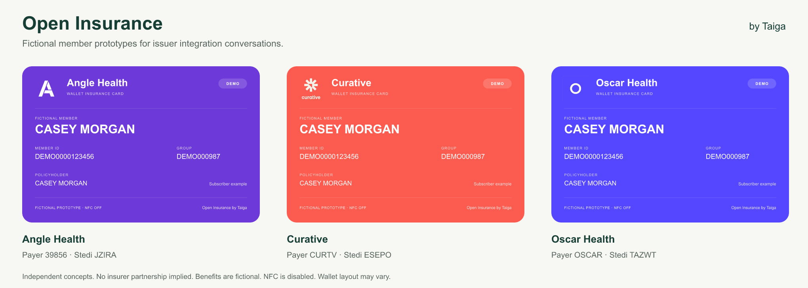

# Partner prototypes

Generate fictional Angle Health, Curative and Oscar Health examples from the repository root:

```sh
bun run prototypes --out /tmp/open-insurance-prototypes
```

The command needs no API key, Apple account, hardware or network connection. It creates a new directory and refuses to overwrite an existing one. All files are owner-only. Subscriber and dependent examples use the same fictional policyholder with clearly marked demo identifiers.



## Bundle contents

`contact-sheet.png` compares all three subscriber cards. Each insurer directory contains `card.png`, `card.svg`, `card.json`, `insurance.json`, `issuer.json`, unsigned `pass.json`, `benefits.json`, `stedi-request.json`, and `reader-result.json`. Its `dependent/` directory contains the corresponding dependent example. `manifest.json` indexes the six cards.

The generator issues and resolves each card through the SDK and preserves the full supplied benefits object. `reader-result.json` records that simulated resolution; no reader or hosted resolver is connected to these exported references. Exported validity labels reflect generation time. The request is composed with a fictional clinic and is never sent. Credential references expire after 30 days; the fictional benefits window is one day and remains labeled with its original timestamps.

The PNGs are visual concepts. Apple controls Wallet layout. Demo pass JSON shows `DEMO` and `FICTIONAL MEMBER`, identifies Open Insurance by Taiga as its organization, and explains its independent fictional status in the pass details.

## Optional Wallet installation

Provide your own ordinary Apple Wallet signing configuration outside the checkout:

```sh
bun run prototypes --out /private/path/partner-prototypes \
  --issuer /private/path/issuer.json \
  --signer-cert /private/path/signer-cert.pem \
  --signer-key /private/path/signer-key.pem \
  --wwdr /private/path/wwdr.pem
```

The issuer file follows the [Wallet configuration](integration.md#signing-and-persistence). Only its `passTypeIdentifier` and `teamIdentifier` are reused; prototype branding and demo labels are explicit. NFC is disabled even if the input configuration contains an NFC encryption key. An encrypted signer key uses `INSURANCE_CARD_SIGNER_KEY_PASSPHRASE`.

Signing adds `insurance.pkpass` to each card directory. Transfer an individual file to an iPhone and open it to review the Wallet installation. Ordinary signing does not establish NFC permission or insurer authorization. Keep signing inputs and signed artifacts outside Git.

## Payer metadata and artwork

| Prototype | Primary payer ID | Stedi ID | Directory source | Logo source |
| --- | --- | --- | --- | --- |
| Angle Health | `39856` | `JZIRA` | [Stedi record](https://www.stedi.com/healthcare/network/JZIRA) | [Avatar](https://prod-payer-avatars.payers.us.stedi.com/JZIRA/avatar.png?v=1768282781355) |
| Curative | `CURTV` | `ESEPO` | [Stedi record](https://www.stedi.com/healthcare/network/ESEPO) | [Avatar](https://prod-payer-avatars.payers.us.stedi.com/ESEPO/avatar.png?v=1762358854822) |
| Oscar Health | `OSCAR` | `TAZWT` | [Stedi record](https://www.stedi.com/healthcare/network/TAZWT) | [Avatar](https://prod-payer-avatars.payers.us.stedi.com/TAZWT/avatar.png?v=1761829613732) |

The presets are independent integration concepts, not partner endorsements. Logo files come from Stedi's public payer avatars; colors are prototype settings, not colors supplied by the Stedi API. Review current routing against the participating member's plan. The prototype uses the bundled legacy Stedi request contract; it does not assert that a real eligibility inquiry will succeed for every member or provider.

For production, replace fictional enrollment and benefits with authoritative issuer data and provide authenticated issuance, clinic authorization, persistent storage and member distribution. See [architecture](architecture.md) for deployment responsibilities and NFC limits.
